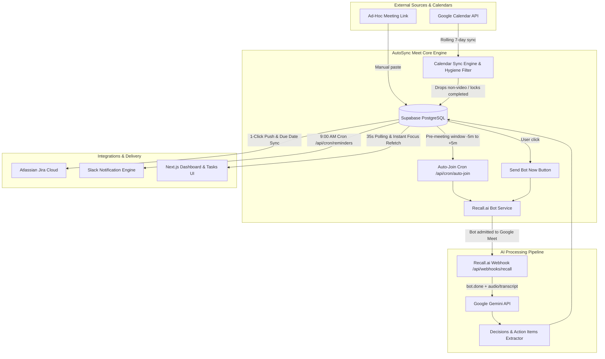
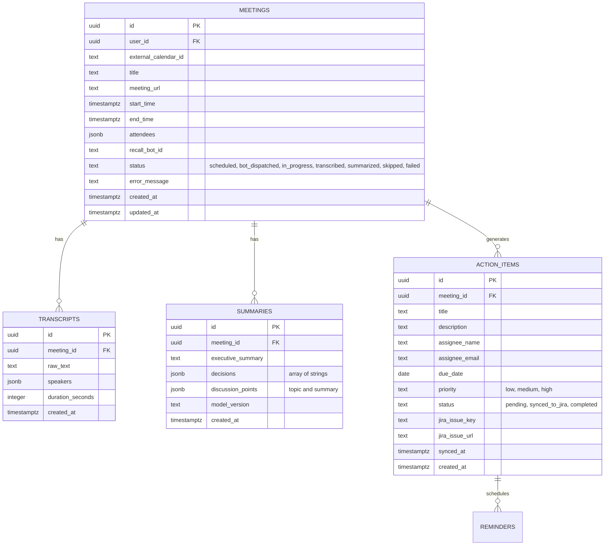

# AutoSync Meet — System Architecture & Project Memory Specification

> **Target Audience:** Engineering team & AI models onboarding onto the codebase.  
> **Repository Root:** `c:\EDAI7`  
> **Last Updated:** November 2026

---

## 1. Executive Summary & Purpose

**AutoSync Meet** is an automated enterprise meeting intelligence and action-item execution platform. It captures Google Meet video calls, generates verbatim multi-speaker transcripts, extracts actionable decisions and tasks using Google Gemini AI, and synchronizes those outcomes into Atlassian Jira Cloud and Slack.

### Core Value Proposition
- **Zero-Friction Bot Dispatch:** Bots can be automatically dispatched via a 5-minute pre-meeting background cron or manually dispatched with a single click.
- **Calendar & Transport Hygiene:** Filters out non-video personal calendar blocks (train tickets, flights, doctor visits) while locking completed meetings as permanent audit records.
- **Smart Task Execution:** Captures decisions vs. commitments, offers 1-click inline deadline presets (`Tomorrow`, `Friday`, `Next Monday`), and synchronizes due dates directly with Jira Cloud issues in real time.

---

## 2. Technology Stack & Key Libraries

| Layer | Technologies | Role / Purpose |
| :--- | :--- | :--- |
| **Framework** | Next.js 14 (App Router) | Server-side rendering, client routing, API routes (`/src/app`) |
| **Language** | TypeScript (Strict mode) | Type safety, database schemas, API contracts |
| **Styling** | Vanilla CSS (`dashboard.css`, `globals.css`) | Custom dark-glass design system, responsive breakpoints |
| **Database & Auth** | Supabase (PostgreSQL, Supabase Auth) | Row Level Security (RLS), admin & server clients |
| **LLM & AI** | Google Gemini (`@google/genai`) | Summarization, speaker segmentation, decision & task extraction |
| **Meeting Bot** | Recall.ai REST API & Webhooks | Headless Google Meet capture, audio streaming, real-time status |
| **Calendar Sync** | Google Calendar API v3 | Rolling 7-day upcoming events sync via OAuth 2.0 |
| **Integrations** | Atlassian Jira Cloud REST API v3, Slack | Two-way task creation, issue tracking, due date updates |
| **Icons** | Lucide React | Minimal vector iconography |

---

## 3. System Architecture & Workflows



---

## 4. Key Subsystems & Implementation Rules

### 4.1. Google Calendar Sync & Hygiene Filter
- **Location:** `src/lib/services/google-calendar.ts` & `src/app/api/calendar/sync/route.ts`
- **Sync Window:** Rolling 7-day window (`now` to `now + 7 days`).
- **Strict Video Link Validation:** Only accepts genuine Google Meet URLs matching:
  $$\text{https://meet.google.com/[a-z]{3}-[a-z]{4}-[a-z]{3}}$$
- **Transport / Booking Exclusion:** Discards events with titles starting with:
  `Train to`, `Flight to`, `Booking`, `Reservation`, `Appointment`, or `Lunch`.
- **Completion Lock (Immutability):** Sync cleanup **never** overwrites or deletes meetings with `status === 'summarized'`, `status === 'transcribed'`, or `decision_count > 0`.

### 4.2. Meeting Status State Machine
Meetings progress through defined states:
$$\text{scheduled} \longrightarrow \text{bot\_dispatched} \longrightarrow \text{in\_progress} \longrightarrow \text{transcribed} \longrightarrow \text{summarized}$$
- `skipped`: Set when a user clicks the top-right ✕ button. Bot will not join.
- `failed`: Set if Recall.ai fails or video URL is invalid.

### 4.3. Top-Right ✕ Skip & Undo Architecture
- **Location:** `src/app/(dashboard)/meetings/page.tsx` & `src/components/dashboard/HeroMeetingCard.tsx`
- **Button Styling:** 36px visible footprint inside a 44px hit-area, `background: rgba(255, 255, 255, 0.04)`, `1px solid #1D2232`, Lucide `<X size={15} />`.
- **Top-Right Anchor:** Positioned at `top: 16px; right: 16px;`.
- **Card Two-Tier Layout (Zero Overlap Guarantee):**
  - **Top Tier (`.meetings-upcoming-card-top`):** Contains badges and meeting title, with `padding-right: 56px` to reserve the corner exclusively for the ✕ button.
  - **Bottom Tier (`.meetings-upcoming-card-bottom`):** Places date & bot status on the left, and the action toolbar (`Send bot now`, `Open in Meet`, `View details`) on the bottom-right.
- **8-Second Undo Window:** Clicking ✕ marks status `skipped` and shows a floating undo banner with an 8-second countdown.
- **In-Call Toggle:** Once the bot is dispatched or active, the button becomes a red glass **"Stop bot"** button (`<Square size={13} fill="currentColor" />`).

### 4.4. Action Items & 1-Click Inline Deadline Editor (P1)
- **Component:** `src/components/tasks/TaskDueDatePopover.tsx`
- **Page:** `src/app/(dashboard)/tasks/page.tsx`
- **UX Strategy:**
  - Deadlines are **optional**. If a speaker mentions a deadline (*"by Friday"*), Gemini parses it. If unmentioned, `due_date` is `null`.
  - Displays as `+ Set deadline` (muted dashed border) or 📅 `Nov 27` (cyan glass badge).
  - Clicking opens a 1-click popover with presets:
    - ⚡ **Today**
    - ⚡ **Tomorrow**
    - ⚡ **This Friday**
    - ⚡ **Next Monday**
    - 📅 **Custom Date Picker**
    - ✕ **Clear deadline**
  - Updates locally via optimistic state and persists via `PATCH /api/action-items`.

### 4.5. Two-Way Jira Due Date Synchronization (P2)
- **Service:** `src/lib/services/jira.ts` (`updateJiraIssueDueDate`)
- **API Endpoint:** `PATCH /api/action-items`
- **Workflow:**
  - When an action item that already has a `jira_issue_key` (e.g. `PROJ-104`) has its deadline set, changed, or cleared:
  - The backend calls Jira Cloud REST API v3 (`PUT /rest/api/3/issue/{key}`) with `fields: { duedate: "YYYY-MM-DD" }`.
  - Displays feedback toast: *"Deadline updated and synced to Jira issue PROJ-104"*.

### 4.6. Automated Bot Auto-Join Cron (P3)
- **Route:** `src/app/api/cron/auto-join/route.ts`
- **Scheduler Config:** `vercel.json` (`schedule: "* * * * *"`)
- **Start-Window Evaluation:**
  - Evaluates all `status: 'scheduled'` meetings with Google Meet URLs.
  - If `start_time` is between **10 minutes ago** and **5 minutes from now**, it automatically triggers `dispatchRecallBot` and marks the meeting `bot_dispatched`.
  - Manual local testing: `http://localhost:3000/api/cron/auto-join?force=true` or `?meeting_id=<ID>`.

### 4.7. Real-Time Client Polling
- **Context:** `src/lib/context/DashboardContext.tsx`
- **Mechanism:**
  - Background polling every **35 seconds** (`setInterval(..., 35000)`).
  - Instant refetch on `window.onfocus` and `document.visibilitychange`.
  - Shows temporary indicator: *"Updated just now"* (clears after 5 seconds).
  - Polling reads the database; it does not write or generate unnecessary write traffic.

---

## 5. Database Schema (Supabase PostgreSQL)



---

## 6. Directory Structure & Key Files

```
c:\EDAI7
├── src/
│   ├── app/
│   │   ├── (auth)/login/page.tsx               # Supabase OAuth login
│   │   ├── (dashboard)/
│   │   │   ├── dashboard/page.tsx              # Main overview with Hero Meeting Card
│   │   │   ├── meetings/page.tsx               # Upcoming and Completed meetings list
│   │   │   ├── meetings/[id]/page.tsx          # Meeting details, transcript turns, decisions
│   │   │   ├── tasks/page.tsx                  # Action items table with inline deadline editor
│   │   │   └── settings/page.tsx               # Jira & Slack credentials setup
│   │   ├── api/
│   │   │   ├── action-items/route.ts           # GET, POST, DELETE, PATCH (P1/P2 due dates)
│   │   │   ├── bot/dispatch/route.ts           # Manual bot join trigger
│   │   │   ├── calendar/sync/route.ts          # Google Calendar hygiene sync
│   │   │   ├── cron/auto-join/route.ts         # P3: Auto-dispatch cron route
│   │   │   ├── cron/reminders/route.ts         # Daily Slack action item reminders
│   │   │   ├── integrations/jira/route.ts      # Push tasks to Jira Cloud
│   │   │   └── webhooks/recall/route.ts        # Recall.ai bot event webhooks
│   │   ├── dashboard.css                       # Complete dashboard design system
│   │   └── globals.css                         # Global CSS resets & variables
│   ├── components/
│   │   ├── dashboard/
│   │   │   ├── HeroMeetingCard.tsx             # Featured upcoming meeting with 4-stage stepper
│   │   │   ├── MetricsStack.tsx                # Metric badges (Tasks waiting vs synced)
│   │   │   └── RecentMeetingsTable.tsx         # Recent meeting history table
│   │   ├── tasks/
│   │   │   └── TaskDueDatePopover.tsx          # P1 1-click deadline popover component
│   │   └── meetings/
│   │       └── AdHocMeetingModal.tsx           # Paste Google Meet link modal
│   ├── lib/
│   │   ├── context/DashboardContext.tsx        # Centralized state, polling, dispatch methods
│   │   ├── services/
│   │   │   ├── google-calendar.ts              # Calendar sync, link hygiene filters
│   │   │   ├── jira.ts                         # Jira REST v3 issue creation & due date sync
│   │   │   ├── meeting-store.ts                # Supabase database abstraction layer
│   │   │   ├── recall-bot.ts                   # Recall.ai bot dispatch & mock simulator
│   │   │   └── reminder-engine.ts              # Slack / email reminder dispatch engine
│   │   └── supabase/
│   │       ├── admin.ts                        # Service role admin client
│   │       └── server.ts                       # Server-side user client
│   └── types/
│       └── database.ts                         # Complete TypeScript interfaces
├── vercel.json                                 # Cron job schedules (9:00 AM reminders + auto-join)
└── package.json                                # Dependencies & scripts
```

---

## 7. Important Development Gotchas

> [!IMPORTANT]
> **Do not run `npm run build` concurrently with an active `next dev` server.**  
> Next.js wipes `.next` during `build`, replacing development webpack chunks (`main-app.js`, `app-pages-internals.js`) with production hashes. If `next dev` is running, the open browser session will receive `404 Not Found` errors for static assets until restarted. Verify changes using `npx tsc --noEmit`.

> [!NOTE]
> **Offline Demo Mode vs. Production API Keys:**  
> The codebase contains graceful fallback simulation. If `RECALL_AI_API_KEY`, `JIRA_API_TOKEN`, or `GOOGLE_CLIENT_ID` are placeholders or unconfigured, the application simulates realistic bot transcripts, issue keys (`ENG-101`), and demo data without crashing.
