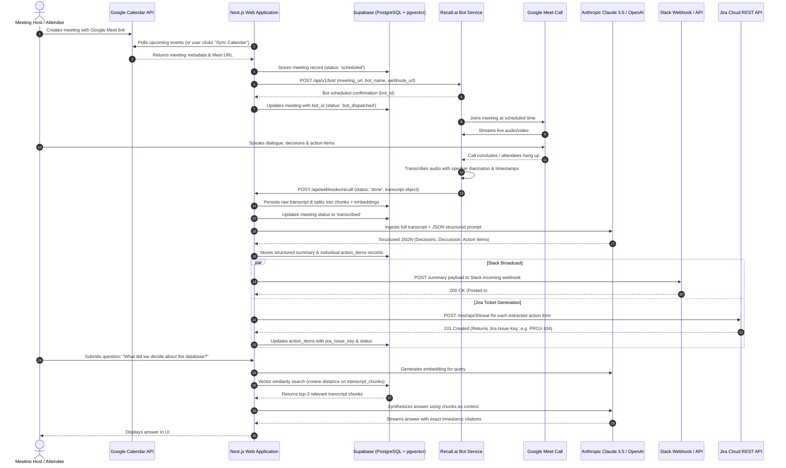

# System Architecture & Technical Specification
## AI Meeting Assistant Platform (Phase 1 MVP)

---

### 1. End-to-End Data Flow

The platform coordinates asynchronous external services (Google Calendar, Recall.ai, Anthropic/OpenAI, Slack, and Jira) through a centralized Next.js backend and a Supabase PostgreSQL database equipped with `pgvector`.



---

### 2. Full Technical Stack

| Layer | Technology | Selection Rationale |
| :--- | :--- | :--- |
| **Full-Stack Framework** | **Next.js 14+ (App Router, TypeScript)** | Unified codebase for React frontend and serverless API route handlers. Rapid iteration, SSR/RSC speed, and seamless deployment. |
| **Styling & Design System** | **Vanilla CSS + CSS Modules** | Zero external CSS framework lock-in, ultra-fast render performance, fine-grained control over corporate dark/light glassmorphic tokens without Tailwind bloat. |
| **Database & Auth** | **Supabase (PostgreSQL + Auth + pgvector)** | Hosted relational database with instant Row-Level Security (RLS), built-in Google OAuth2, native vector search extension (`pgvector`) for transcript embeddings, and instant REST/real-time subscriptions. |
| **Meeting Bot Infrastructure** | **Recall.ai API** | Universal meeting-bot-as-a-service. Avoids spinning up custom Chromium instances, headless audio routing, or virtual sound cards on bare VMs. Handles Google Meet / Zoom natively. |
| **Speech-to-Text (STT)** | **Recall.ai Built-in Transcription** | Automated transcription with speaker diarization and millisecond-accurate timestamps provided directly in Recall.ai webhook payloads (Deepgram/Whisper under the hood). |
| **AI Summarization & Q&A** | **Anthropic Claude 3.5 Sonnet / OpenAI GPT-4o** | High reasoning capability, large context windows (200k tokens), and robust structured JSON mode adherence for extracting decisions and tasks. Embeddings via `text-embedding-3-small`. |
| **Calendar Sync** | **Google Calendar API (v3)** | Read-only access to primary calendars to pull upcoming meetings, Google Meet URLs, and attendee email lists. |
| **Team Messaging** | **Slack Web API / Incoming Webhooks** | Posting formatted BlockKit summaries into team channels. |
| **Issue Tracking** | **Jira Cloud REST API (v3)** | Creating task issues with descriptions, story points, assignees, and deadlines. |
| **Hosting & Operations** | **Vercel + Supabase Cloud** | Zero-devops deployment pipeline with free tier support ideal for rapid college MVP demonstration. |

---

### 3. Proposed Project Directory Structure

```text
ai-meeting-assistant/
├── README.md
├── PRD.md
├── Architecture.md
├── Rules.md
├── Phases.md
├── Design.md
├── package.json
├── tsconfig.json
├── next.config.mjs
├── .env.example
├── .gitignore
├── supabase/
│   ├── migrations/
│   │   ├── 00001_initial_schema.sql
│   │   └── 00002_vector_search.sql
│   └── seed.sql
├── public/
│   ├── logo.svg
│   └── icons/
├── src/
│   ├── app/
│   │   ├── layout.tsx
│   │   ├── page.tsx                     # Landing / Overview page
│   │   ├── globals.css                  # Design tokens & base reset
│   │   ├── (auth)/
│   │   │   ├── login/page.tsx
│   │   │   └── callback/route.ts        # Supabase OAuth redirect handler
│   │   ├── (dashboard)/
│   │   │   ├── layout.tsx               # Sidebar + Header layout
│   │   │   ├── dashboard/page.tsx       # Upcoming meetings & overview
│   │   │   ├── meetings/
│   │   │   │   ├── page.tsx             # All past & upcoming meetings
│   │   │   │   └── [id]/page.tsx        # Meeting detail: Transcript, Summary, Q&A
│   │   │   ├── tasks/page.tsx           # Action items & Jira sync view
│   │   │   └── settings/page.tsx        # Integration status & tokens
│   │   └── api/
│   │       ├── calendar/
│   │       │   └── sync/route.ts        # Poll/sync Google Calendar
│   │       ├── bot/
│   │       │   └── dispatch/route.ts    # Send bot to meeting URL
│   │       ├── webhooks/
│   │       │   └── recall/route.ts      # Ingest transcripts from Recall.ai
│   │       ├── summarize/
│   │       │   └── route.ts             # Trigger LLM summarization
│   │       ├── qa/
│   │       │   └── route.ts             # Semantic search & Q&A retrieval
│   │       ├── integrations/
│   │       │   ├── slack/route.ts       # Broadcast to Slack
│   │       │   └── jira/route.ts        # Push action items to Jira
│   │       └── cron/
│   │           └── reminders/route.ts   # Check pending tasks & send reminders
│   ├── components/
│   │   ├── ui/                          # Button, Modal, Card, Input, Badge, Tabs
│   │   ├── layout/                      # Sidebar, Header, UserMenu
│   │   ├── meetings/                    # MeetingCard, TranscriptViewer, SummaryBox
│   │   ├── tasks/                       # TaskTable, JiraSyncButton, AssigneeBadge
│   │   ├── qa/                          # ChatDrawer, QAMessageList, CitationPill
│   │   └── settings/                    # IntegrationCard, ConnectButton
│   ├── lib/
│   │   ├── supabase/
│   │   │   ├── client.ts                # Client-side Supabase browser client
│   │   │   ├── server.ts                # Server-side Supabase cookie client
│   │   │   └── admin.ts                 # Service-role privileged client
│   │   ├── services/
│   │   │   ├── google-calendar.ts       # Google Calendar API service
│   │   │   ├── recall-bot.ts            # Recall.ai bot dispatch & webhook client
│   │   │   ├── llm-summarizer.ts        # Claude/OpenAI prompt & structured JSON
│   │   │   ├── embeddings.ts            # Vector chunking & embedding generation
│   │   │   ├── slack.ts                 # Slack BlockKit message builder & webhook
│   │   │   ├── jira.ts                  # Jira Cloud REST v3 issue creator
│   │   │   └── reminder-engine.ts       # Action item deadline reminder evaluator
│   │   └── utils/
│   │       ├── date.ts                  # Date & duration formatters
│   │       └── text.ts                  # String sanitation & transcript parsers
│   └── types/
│       ├── database.ts                  # Auto-generated or typed Supabase schema
│       ├── meeting.ts
│       ├── transcript.ts
│       ├── summary.ts
│       └── integrations.ts
```

---

### 4. Database Schema Overview (PostgreSQL + pgvector)

```sql
-- Enable UUID and pgvector extensions
CREATE EXTENSION IF NOT EXISTS "uuid-ossp";
CREATE EXTENSION IF NOT EXISTS "vector";

-- 1. USERS & PROFILES (Linked to Supabase Auth)
CREATE TABLE public.profiles (
    id UUID PRIMARY KEY REFERENCES auth.users(id) ON DELETE CASCADE,
    email TEXT NOT NULL UNIQUE,
    full_name TEXT,
    avatar_url TEXT,
    created_at TIMESTAMPTZ DEFAULT NOW(),
    updated_at TIMESTAMPTZ DEFAULT NOW()
);

-- 2. USER INTEGRATIONS (Store tokens securely)
CREATE TABLE public.integrations (
    id UUID PRIMARY KEY DEFAULT uuid_generate_v4(),
    user_id UUID NOT NULL REFERENCES public.profiles(id) ON DELETE CASCADE,
    provider TEXT NOT NULL, -- 'google_calendar', 'slack', 'jira'
    access_token TEXT,
    refresh_token TEXT,
    webhook_url TEXT, -- For Slack incoming webhooks
    jira_domain TEXT, -- e.g. "myorg.atlassian.net"
    jira_project_key TEXT, -- e.g. "ENG"
    metadata JSONB DEFAULT '{}'::jsonb,
    is_active BOOLEAN DEFAULT TRUE,
    created_at TIMESTAMPTZ DEFAULT NOW(),
    updated_at TIMESTAMPTZ DEFAULT NOW(),
    UNIQUE(user_id, provider)
);

-- 3. MEETINGS
CREATE TABLE public.meetings (
    id UUID PRIMARY KEY DEFAULT uuid_generate_v4(),
    user_id UUID NOT NULL REFERENCES public.profiles(id) ON DELETE CASCADE,
    external_calendar_id TEXT, -- Google Calendar Event ID
    title TEXT NOT NULL,
    meeting_url TEXT NOT NULL, -- Google Meet link
    start_time TIMESTAMPTZ NOT NULL,
    end_time TIMESTAMPTZ NOT NULL,
    attendees JSONB DEFAULT '[]'::jsonb, -- [{name, email}]
    recall_bot_id TEXT UNIQUE,
    status TEXT NOT NULL DEFAULT 'scheduled', 
    -- 'scheduled' | 'bot_dispatched' | 'in_progress' | 'transcribed' | 'summarized' | 'failed'
    error_message TEXT,
    created_at TIMESTAMPTZ DEFAULT NOW(),
    updated_at TIMESTAMPTZ DEFAULT NOW()
);

-- 4. RAW TRANSCRIPTS & CHUNKS (For Full View & Vector Retrieval)
CREATE TABLE public.transcripts (
    id UUID PRIMARY KEY DEFAULT uuid_generate_v4(),
    meeting_id UUID NOT NULL REFERENCES public.meetings(id) ON DELETE CASCADE,
    raw_text TEXT NOT NULL,
    speakers JSONB DEFAULT '[]'::jsonb, -- list of detected speaker names
    duration_seconds INTEGER,
    created_at TIMESTAMPTZ DEFAULT NOW()
);

CREATE TABLE public.transcript_chunks (
    id UUID PRIMARY KEY DEFAULT uuid_generate_v4(),
    transcript_id UUID NOT NULL REFERENCES public.transcripts(id) ON DELETE CASCADE,
    meeting_id UUID NOT NULL REFERENCES public.meetings(id) ON DELETE CASCADE,
    speaker_name TEXT,
    start_time_offset NUMERIC(8, 2), -- in seconds from call start
    end_time_offset NUMERIC(8, 2),
    chunk_text TEXT NOT NULL,
    embedding vector(1536), -- 1536-dim for OpenAI / compatible models
    created_at TIMESTAMPTZ DEFAULT NOW()
);

CREATE INDEX idx_transcript_chunks_embedding 
ON public.transcript_chunks USING hnsw (embedding vector_cosine_ops);

-- 5. AI SUMMARIES (Decisions & Discussions)
CREATE TABLE public.summaries (
    id UUID PRIMARY KEY DEFAULT uuid_generate_v4(),
    meeting_id UUID NOT NULL REFERENCES public.meetings(id) ON DELETE CASCADE,
    executive_summary TEXT NOT NULL,
    decisions JSONB DEFAULT '[]'::jsonb, -- ["Decision 1", "Decision 2"]
    discussion_points JSONB DEFAULT '[]'::jsonb, -- [{topic, summary}]
    model_version TEXT NOT NULL,
    created_at TIMESTAMPTZ DEFAULT NOW()
);

-- 6. ACTION ITEMS (Syncable to Jira)
CREATE TABLE public.action_items (
    id UUID PRIMARY KEY DEFAULT uuid_generate_v4(),
    meeting_id UUID NOT NULL REFERENCES public.meetings(id) ON DELETE CASCADE,
    title TEXT NOT NULL,
    description TEXT,
    assignee_name TEXT,
    assignee_email TEXT,
    due_date TIMESTAMPTZ,
    priority TEXT DEFAULT 'medium', -- 'low' | 'medium' | 'high'
    status TEXT DEFAULT 'pending', -- 'pending' | 'synced_to_jira' | 'completed'
    jira_issue_key TEXT, -- e.g. "ENG-104"
    jira_issue_url TEXT,
    synced_at TIMESTAMPTZ,
    created_at TIMESTAMPTZ DEFAULT NOW()
);

-- 7. TASK REMINDERS
CREATE TABLE public.reminders (
    id UUID PRIMARY KEY DEFAULT uuid_generate_v4(),
    action_item_id UUID NOT NULL REFERENCES public.action_items(id) ON DELETE CASCADE,
    recipient_email TEXT NOT NULL,
    scheduled_for TIMESTAMPTZ NOT NULL,
    sent_at TIMESTAMPTZ,
    status TEXT DEFAULT 'scheduled', -- 'scheduled' | 'sent' | 'cancelled'
    channel TEXT DEFAULT 'slack', -- 'slack' | 'email' | 'in_app'
    created_at TIMESTAMPTZ DEFAULT NOW()
);

-- 8. ARCHITECTURAL ROOM FOR PHASE 2 (ANONYMOUS PEER-HELP MODULE)
-- Not active in Phase 1, but cleanly separated to prevent architectural redesign:
-- CREATE TABLE public.peer_questions (
--     id UUID PRIMARY KEY DEFAULT uuid_generate_v4(),
--     sender_anon_hash TEXT NOT NULL, -- Salted hash preserving sender anonymity
--     topic_tags TEXT[],
--     question_body TEXT NOT NULL,
--     revealed_user_id UUID REFERENCES public.profiles(id), -- Nullable until voluntary reveal
--     status TEXT DEFAULT 'open',
--     created_at TIMESTAMPTZ DEFAULT NOW()
-- );
```

---

### 5. External APIs & Responsibilities

| API Name | Endpoint / Protocol | Primary Responsibility |
| :--- | :--- | :--- |
| **Google Calendar API (v3)** | `GET https://www.googleapis.com/calendar/v3/calendars/primary/events` | Queries scheduled calendar entries to identify Google Meet links, meeting titles, start times, and attendee email addresses. |
| **Recall.ai Bot API** | `POST https://api.recall.ai/api/v1/bot/` & Webhook listener | Provisions a virtual bot to join Google Meet rooms, handles media negotiation, records audio, generates timestamped diarized transcripts, and fires completed payloads to `/api/webhooks/recall`. |
| **Anthropic Claude API / OpenAI API** | `POST https://api.anthropic.com/v1/messages` or `POST https://api.openai.com/v1/chat/completions` | Extracts structured JSON (Decisions, Discussions, Action Items) with strict schema validation. Also computes text embeddings (`text-embedding-3-small`) for chunk retrieval and synthesizes answers for transcript Q&A. |
| **Slack API** | `POST <incoming_webhook_url>` or `POST https://slack.com/api/chat.postMessage` | Dispatches rich BlockKit meeting summaries and urgent action item reminders to team channels. |
| **Jira Cloud REST API (v3)** | `POST https://<domain>.atlassian.net/rest/api/3/issue` | Programmatically creates tracking issues under designated Jira projects with summary, description, due date, and mapped user assignees. |
| **Supabase REST & Realtime** | Client SDK & PostgreSQL | Authentication session management, RLS data persistence, real-time status subscription on the dashboard, and vector cosine similarity queries. |

---

### 6. Assumptions & Pragmatic Engineering Decisions

Because this is a multi-week college project designed to produce a rock-solid, live demo without enterprise infrastructure overhead, the following architectural simplifications are made:

1. **Calendar Polling vs. Push Notifications**:
   - *Decision*: The application uses client-triggered polling ("Sync Calendar" button) and an automated 5-minute background check, instead of configuring Google Cloud Pub/Sub push webhooks.
   - *Rationale*: Google Push Notifications require verified domain ownership, SSL webhooks with complex renewal handshakes, and GCP Pub/Sub setups that add friction without demo value.
2. **Recall.ai Built-in Transcription vs. Custom STT**:
   - *Decision*: Ingest the transcription payload provided directly by Recall.ai upon call completion.
   - *Rationale*: Running standalone Whisper models or managing real-time audio WebSocket pipes would introduce audio buffering failure points and deployment size complications.
3. **Slack Incoming Webhooks vs. Full Slack App Directory OAuth**:
   - *Decision*: The user configures an Incoming Webhook URL in the Settings view.
   - *Rationale*: Standard incoming webhooks post rich BlockKit messages with zero OAuth review overhead and zero risk of token expiration during the live presentation.
4. **Jira API Token vs. Multi-Tenant 3LO OAuth**:
   - *Decision*: Authenticate with Jira Cloud using an Atlassian API Token + User Email and Atlassian domain.
   - *Rationale*: Eliminates fragile 3-legged OAuth redirects while retaining 100% of Jira REST API v3 issue creation capabilities.
5. **pgvector in Supabase vs. Dedicated Pinecone Cluster**:
   - *Decision*: Store chunk embeddings in the same PostgreSQL database using `pgvector`.
   - *Rationale*: Eliminates external vector DB synchronization issues, reduces hosting complexity to a single database instance, and enables single-query joins between chunks, meetings, and users.
