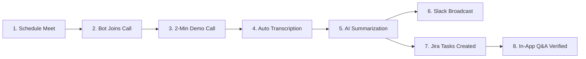

# Project Requirements Document (PRD)
## AI Meeting Assistant Platform (Phase 1 MVP)

---

### 1. Problem Statement
In modern corporate and engineering teams, critical strategic decisions, architectural compromises, and task commitments are established verbally in meetings but routinely slip through the cracks due to fragmented manual workflows. Team members and managers spend substantial hours manually typing up imperfect meeting notes, cross-referencing action items, and creating tracking tickets in issue trackers like Jira. Inevitably, assignments lose clear ownership and deadlines, follow-ups are neglected, and historical rationale behind decisions becomes trapped in lost video recordings or unsearchable chat threads. This platform automates the entire lifecycle—from bot entry and transcription to structured extraction, Jira ticket dispatch, Slack broadcasting, and context-aware Q&A—eliminating human transcription overhead and ensuring 100% accountability on meeting deliverables.

---

### 2. Target Users

| User Persona | Key Pain Points | Primary MVP Benefit |
| :--- | :--- | :--- |
| **Corporate Employees & Engineers** | Context-switching between calls and Jira; forgetting action items assigned verbally; manual note-taking during meetings. | Zero-effort note capture; automated Jira tasks assigned directly to them; ability to query past meetings instantly. |
| **Team Leads & Engineering Managers** | Following up manually on verbal commitments; lack of visibility into cross-functional decisions; meeting summary drafting overhead. | Automated summary broadcasts to Slack; structured tracking of decisions vs. action items; automated assignee reminders. |
| **Product Managers & Scrum Masters** | Manually converting sprint review / refinement notes into backlog issues; verifying if sprint action items have assigned owners and due dates. | Direct one-click or automated creation of Jira issues with assignees and target completion dates extracted from conversation context. |
| **Small-to-Mid-Sized Tech Teams** | Inability to afford bloated enterprise meeting intelligence suites; reliance on disjointed free tools. | Lightweight, unified platform that links Google Calendar, Google Meet, Slack, and Jira seamlessly. |

---

### 3. MVP Goals (Specific, Demoable Outcomes)
1. **Dual-Engine Meeting Ingestion**:
   - **Engine A (Google Meet Bot)**: Detect upcoming Google Meet calls from a user's linked Google Calendar and dispatch a virtual bot (via Recall.ai) that joins the call automatically.
   - **Engine B (Native In-App WebRTC Studio)**: Provide a zero-bot, zero-lobby in-app video studio (`/meet/[id]`) with hardware camera/mic controls, screen sharing, multi-peer WebRTC mesh (up to 5-6 participants), and 1-click room link sharing, completely bypassing Google Meet anti-bot restrictions.
2. **High-Accuracy Diarized Transcription**: Ingest speaker-attributed, timestamped audio transcriptions from either the Recall.ai bot session or directly from the in-browser ultra-fast speech recognition pipeline (<200ms live typing with 1.2s auto-finalization).
3. **Structured AI Synthesis**: Automatically parse raw transcripts using LLMs (Google Gemini 2.5 Flash / Anthropic Claude / OpenAI GPT-4o) into three discrete categories:
   - **Decisions Made** (binding conclusions reached by the group).
   - **Discussion Points** (key debate topics, alternatives considered, context).
   - **Action Items** (actionable deliverables explicitly tagged with an assignee and a clear or inferred deadline).
4. **Automated Team Broadcast (Slack)**: Post formatted meeting summaries directly to a configured Slack channel via webhook or bot token within minutes of meeting conclusion.
5. **Instant Jira Ticket Creation & Status Sync**: Automatically (or via one-click confirmation) generate Jira issues for each extracted action item with summary, description, assignee email mapping, due date, auto-transition to "To Do", and bi-directional status reflection.
6. **Task Reminder Engine**: Schedule and dispatch automated reminders to action item owners before their deadline expires.
7. **Conversational Transcript Q&A**: Provide a natural-language search and chat interface across all historical transcripts using semantic embeddings and vector retrieval.

---

### 4. Non-Goals & Scope Clarifications (Phase 1)
The following features are clarified or deferred from Phase 1 to guarantee a reliable, polished college project demo:

* **Deferred Feature: Anonymous Peer-Help Module**:
  - *Description*: A capability allowing employees to broadcast questions anonymously to teammates and selectively reveal identity upon receiving helpful answers.
  - *Phase 1 Strategy*: **Explicitly out of scope**. No UI, database tables, or endpoints for peer help will be implemented in Phase 1. The architecture maintains a modular schema design so that this service can plug in seamlessly during Phase 2.
* **Native In-App Studio vs. Headless WebRTC Scraping**:
  - Scraping Google Meet via headless Playwright/Puppeteer is strictly avoided due to Google's anti-bot detection ("You can't join this video call").
  - Instead, the platform offers a sanctioned, zero-lobby **In-App WebRTC Studio (`/meet/[id]`)** with Supabase Realtime broadcast signaling alongside Recall.ai.
* **Real-Time Live Translation / Sentiment Analysis**: Live in-call sentiment charts or streaming multi-lingual translation will not be built for the MVP.
* **Native Mobile Apps (iOS/Android)**: Responsive web application only.
* **Enterprise SSO & SOC2 Compliance**: Custom SAML/SCIM and compliance auditing are omitted in favor of Supabase standard Auth and Google OAuth.

---

### 5. Phase 1 Feature List & User Stories

#### Epic 1: Calendar & Meeting Lifecycle
* **US-1.1**: *As an employee*, I want to connect my Google Calendar with one click so the assistant can monitor my scheduled calls.
  * **Acceptance Criteria**: OAuth flow securely saves refresh tokens in Supabase; upcoming meetings for the next 24 hours are listed on the dashboard.
* **US-1.2**: *As an employee*, I want a virtual bot to automatically join my scheduled Google Meet call when it starts without manual dial-in.
  * **Acceptance Criteria**: Assistant schedules a Recall.ai bot for the meeting URL; the bot requests entry and records the call once admitted.
* **US-1.3**: *As an employee*, I want to manually trigger the bot to join an ad-hoc meeting by pasting a Google Meet URL on the dashboard.
  * **Acceptance Criteria**: User inputs a valid Google Meet link; bot enters the call within 30 seconds.

#### Epic 2: Transcription & AI Summarization
* **US-2.1**: *As a meeting attendee*, I want the call conversation accurately transcribed and tagged with speaker names and timestamps.
  * **Acceptance Criteria**: Webhook receives completed transcript from Recall.ai; transcript is saved to the database with speaker labels and start/end time offsets.
* **US-2.2**: *As a busy team member*, I want an AI summary that separates "Decisions", "Discussion Highlights", and "Action Items" so I do not have to read through entire transcripts.
  * **Acceptance Criteria**: LLM prompt enforces strict JSON schema output containing arrays of decisions, discussions, and action items (task title, assignee name/email, deadline, priority).

#### Epic 3: Integrations (Slack & Jira)
* **US-3.1**: *As a team lead*, I want the meeting summary automatically posted into a designated Slack channel immediately after the meeting ends.
  * **Acceptance Criteria**: Markdown/BlockKit message arrives in Slack showing meeting title, attendees, decisions, and action items with deep links back to the web platform.
* **US-3.2**: *As an engineering manager*, I want extracted action items converted into Jira tasks automatically, with assignees and due dates populated.
  * **Acceptance Criteria**: Platform maps attendee email addresses to Jira user accounts and creates issues in the designated Jira Project via Jira Cloud REST API.
* **US-3.3**: *As a user*, I want to review, edit, or toggle action items on the meeting detail page before pushing them to Jira if auto-sync is disabled.
  * **Acceptance Criteria**: Editable table in UI with a "Push Selected to Jira" action button.

#### Epic 4: Task Reminders & Historical Q&A
* **US-4.1**: *As a task owner*, I want to receive automated reminders (in-app and via Slack/Email) when my assigned task's deadline is approaching.
  * **Acceptance Criteria**: Background cron or scheduled check identifies tasks due within 24 hours and triggers a reminder notification.
* **US-4.2**: *As a team member*, I want to ask natural-language questions across all past meetings (e.g., *"What deadline did Sarah propose for the database migration?"*) and receive an accurate answer with citations.
  * **Acceptance Criteria**: User enters prompt; backend generates embeddings, retrieves top-k matching transcript chunks using `pgvector` similarity search, and synthesized answer with meeting title and timestamp references is returned.

---

### 6. Success Criteria for the Demo

The college project presentation will be deemed a complete success if the live 7-minute demonstration passes the following checklist without manual database intervention:

1. **Calendar Ingestion**: The dashboard displays a scheduled Google Meet event fetched from Google Calendar.
2. **Autonomous Bot Entry**: When the call starts, the virtual bot appears in the Google Meet lobby and joins when admitted.
3. **Realistic 2-Minute In-Call Dialogue**:
   - Presenter 1 states: *"We decided to use PostgreSQL rather than MongoDB for our transactional data."*
   - Presenter 2 states: *"Alex will finalize the schema migration script by Friday at 5 PM."*
   - Presenter 1 states: *"Jordan will review the API security policy by Thursday noon."*
4. **Webhook & Summary Pipeline**: Within 30 seconds of hanging up the call, the web application updates in real-time to show:
   - Complete speaker-attributed transcript.
   - Structured Summary: 1 decision recognized, 2 action items identified with correct assignees and deadlines.
5. **Slack Notification**: A structured Slack message arrives in the `#meeting-summaries` channel.
6. **Jira Issue Verification**: Two new tickets appear in the Jira project backlog with correct summaries, descriptions, assignees, and due dates.
7. **Live Interactive Q&A**: Presenter types: *"What database did we decide to use, and who is handling migrations?"*
   - The platform answers accurately: *"The team decided to use PostgreSQL for transactional data. Alex is assigned to finalize the schema migration script by Friday at 5 PM."* with source timestamp citation.
