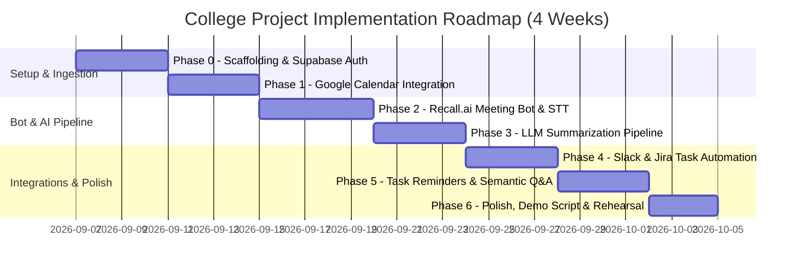

# Implementation Phases & Timeline
## AI Meeting Assistant Platform (Phase 1 MVP)

This document provides a realistic, milestone-driven breakdown designed for a multi-week college timeline. Each phase delivers a standalone, testable capability to ensure that even if time runs short, a working sub-feature can be demonstrated.

---

### Phase Overview & Timeline



---

### Phase 0: Project Scaffolding, Supabase Setup & Authentication
* **Goal**: Establish the repository foundation, install dependencies, configure environment variables, create the database schema in Supabase, and implement user authentication.
* **Concrete Deliverables**:
  - Initialized Next.js 14+ project with TypeScript and App Router.
  - Supabase database project with `00001_initial_schema.sql` applied (profiles, meetings, integrations, transcripts, summaries, action_items).
  - Working Supabase Google OAuth login and session persistence (`src/app/(auth)/login/page.tsx`, `src/lib/supabase/`).
  - Base design system in `src/app/globals.css` (color tokens, dark/light theme foundation).
* **Step-by-Step Tasks**:
  1. Initialize Next.js project: `npx create-next-app@latest . --typescript --no-tailwind --app --src-dir --import-alias "@/*"`.
  2. Install core dependencies: `@supabase/supabase-js`, `@supabase/ssr`, `lucide-react`, `zod`.
  3. Create `.env.example` and local `.env.local` containing Supabase URL, Anon Key, and Service Role Key.
  4. Execute Supabase SQL migrations to create initial tables, indexes, and RLS policies.
  5. Implement auth middleware (`middleware.ts`) to protect dashboard routes (`/dashboard/*`).
* **"Done When" Checkpoint**:
  - A user can click "Sign in with Google", authenticate via Supabase Auth, and be redirected to a protected `/dashboard` showing their profile name and email.

---

### Phase 1: Google Calendar Integration & Meeting Discovery
* **Goal**: Enable users to connect their Google Calendar account, read scheduled events for the upcoming 7 days, and display meetings containing Google Meet links in the dashboard.
* **Concrete Deliverables**:
  - Google Cloud Console OAuth consent screen configured with `https://www.googleapis.com/auth/calendar.readonly` scope.
  - Backend integration service in `src/lib/services/google-calendar.ts`.
  - API endpoint: `GET /api/calendar/sync` to pull and persist meetings in Supabase.
  - UI Component: Upcoming Meetings list in `src/app/(dashboard)/dashboard/page.tsx` with a manual "Sync Calendar" button and an "Ad-hoc Meeting Join" input.
* **Step-by-Step Tasks**:
  1. Configure Google OAuth credentials in Google Cloud Console; obtain Client ID and Client Secret.
  2. Implement OAuth token storage in the `integrations` table in Supabase.
  3. Build `google-calendar.ts` service using the Google Calendar API v3 to list upcoming events.
  4. Parse event details: extract event ID, title, start time, end time, attendees, and Google Meet URL.
  5. Upsert meetings into the `meetings` table with status `'scheduled'`.
* **"Done When" Checkpoint**:
  - Clicking "Sync Calendar" on the dashboard queries the user's real Google Calendar and displays upcoming meetings with their start times and valid Google Meet links.

---

### Phase 2: Meeting Bot Dispatch & Audio Capture (Recall.ai)
* **Goal**: Automatically or manually dispatch a virtual bot via Recall.ai to enter a Google Meet call, record the audio, and receive the completed transcript via webhook.
* **Concrete Deliverables**:
  - Recall.ai account setup and API key configuration.
  - Bot dispatch service: `src/lib/services/recall-bot.ts`.
  - API endpoint: `POST /api/bot/dispatch` (takes `meeting_id` or raw `meeting_url`).
  - Webhook listener: `POST /api/webhooks/recall` (receives bot lifecycle events and transcript payload).
  - Status updater: Meeting status updates from `'scheduled'` -> `'bot_dispatched'` -> `'in_progress'` -> `'transcribed'`.
* **Step-by-Step Tasks**:
  1. Obtain Recall.ai sandbox/production API key and configure in `.env.local`.
  2. Implement `recall-bot.ts` to call `POST https://api.recall.ai/api/v1/bot/` with `meeting_url`, `bot_name: "AutoSync AI Assistant"`, and webhook target URL.
  3. Build the webhook handler in `src/app/api/webhooks/recall/route.ts` to handle:
     - `bot.status_change`: update database meeting status.
     - `transcript.complete`: extract diarized speaker transcript and save to `transcripts` table.
  4. Configure local webhook tunneling (e.g. ngrok or Localtunnel) for development testing.
* **"Done When" Checkpoint**:
  - Pasting a Google Meet URL on the dashboard dispatches the bot. The bot enters the Google Meet room, stays for a 1-minute test conversation, leaves when the call ends, and the full transcript with speaker names appears in the database.

---

### Phase 3: AI Summarization & Action Item Extraction Pipeline
* **Goal**: Ingest the completed meeting transcript and use an LLM to generate a structured executive summary, a list of decisions, and actionable tasks with assignees and deadlines.
* **Concrete Deliverables**:
  - LLM client service: `src/lib/services/llm-summarizer.ts` (Anthropic Claude 3.5 Sonnet / OpenAI GPT-4o).
  - API endpoint: `POST /api/summarize` (processes a transcript and writes to `summaries` and `action_items`).
  - UI Component: Meeting Detail View (`src/app/(dashboard)/meetings/[id]/page.tsx`) with tabs for "Transcript", "Decisions", and "Action Items".
* **Step-by-Step Tasks**:
  1. Construct a bulletproof system prompt enforcing strict JSON schema output:
     ```json
     {
       "executive_summary": "string",
       "decisions": ["string"],
       "discussion_points": [{"topic": "string", "summary": "string"}],
       "action_items": [
         {
           "title": "string",
           "description": "string",
           "assignee_name": "string",
           "assignee_email": "string",
           "due_date": "ISO8601 string or null",
           "priority": "low | medium | high"
         }
       ]
     }
     ```
  2. Call the LLM with the raw transcript.
  3. Parse the returned JSON through a Zod validator.
  4. Insert records into `summaries` table and batch insert tasks into `action_items` table.
* **"Done When" Checkpoint**:
  - Running a sample transcript through the pipeline outputs verified JSON in under 15 seconds, correctly isolating decisions from action items and displaying them in clean UI cards.

---

### Phase 4: Slack Broadcast & Jira Task Automation
* **Goal**: Post meeting summaries to a Slack channel and automatically create tracking tickets in Jira for every extracted action item.
* **Concrete Deliverables**:
  - Slack service: `src/lib/services/slack.ts` formatting BlockKit payloads.
  - Jira Cloud service: `src/lib/services/jira.ts` calling Jira REST API v3 `/rest/api/3/issue`.
  - Settings page (`src/app/(dashboard)/settings/page.tsx`) allowing users to input Slack Webhook URL and Jira credentials (Domain, Email, API Token, Project Key).
  - Trigger logic in `src/app/api/integrations/slack/route.ts` and `src/app/api/integrations/jira/route.ts`.
* **Step-by-Step Tasks**:
  1. Build the Slack BlockKit builder: creates a rich message header with meeting title, date, key decisions in bullet format, and deep link to the web app.
  2. Implement Jira ticket creator:
     - Maps action item title to Jira `summary`.
     - Maps description to Jira `description` (Atlassian Document Format).
     - Maps due date to Jira `duedate` (`YYYY-MM-DD`).
     - Associates with the specified Jira `project.key`.
  3. Save generated Jira issue keys (e.g. `ENG-104`) and web links back to `action_items` table.
* **"Done When" Checkpoint**:
  - Upon meeting completion, a formatted summary card appears in Slack, and genuine Jira tickets are created in the user's Jira board with clickable links in the app.

---

### Phase 5: Task Reminder Engine & Semantic Q&A Retrieval
* **Goal**: Implement periodic reminders for incomplete action items and an interactive chat interface to answer questions across past meeting transcripts using vector embeddings.
* **Concrete Deliverables**:
  - Vector embeddings pipeline: `src/lib/services/embeddings.ts` chunking transcripts and generating embeddings with `text-embedding-3-small`.
  - Vector search SQL function in Supabase (`match_transcript_chunks`).
  - Q&A endpoint: `POST /api/qa` executing cosine distance retrieval and generating grounded answers.
  - Reminder endpoint: `POST /api/cron/reminders` checking tasks due soon and firing notifications.
  - UI Component: Slide-over Q&A Drawer with citation badges linking to exact transcript timestamps.
* **Step-by-Step Tasks**:
  1. Enable `pgvector` in Supabase; create HNSW index on `transcript_chunks.embedding`.
  2. Ingest transcript chunks into `transcript_chunks` with 1536-dimensional embeddings.
  3. Implement semantic similarity search function in Postgres.
  4. Connect the Q&A UI to send user prompts, fetch relevant chunks, and stream answers via Claude/OpenAI.
  5. Build task reminder routine: queries pending action items where `due_date <= NOW() + INTERVAL '24 HOURS'` and triggers alert.
* **"Done When" Checkpoint**:
  - A user can ask: *"What did the team decide about the database?"* in the search bar, and the system returns the exact decision with a timestamp link highlighting the transcript line.

---

### Phase 6: Polish, Error Resilience & Live Demo Preparation
* **Goal**: Conduct end-to-end integration testing, handle failure states gracefully, seed reliable fallback demo data, and rehearse the live presentation script.
* **Concrete Deliverables**:
  - Fallback "Load Sample Meeting" button on the dashboard for zero-risk offline presentation backup.
  - Polished loading skeletons, toast notifications, and empty states across all screens.
  - Rehearsed 7-minute presentation script matching PRD success criteria.
* **Step-by-Step Tasks**:
  1. Implement error boundaries and friendly warning toasts for failed external requests.
  2. Seed the database with 2 realistic pre-recorded meeting transcripts (Sprint Planning, Architecture Review) with pre-generated summaries and Jira links.
  3. Perform a dry-run test of the full live sequence: Google Meet -> Recall.ai Bot -> Claude -> Slack -> Jira -> Q&A.
* **"Done When" Checkpoint**:
  - The complete end-to-end flow executes flawlessly in under 7 minutes, with the fallback sample dataset ready in case conference Wi-Fi or third-party APIs experience intermittent delays.
